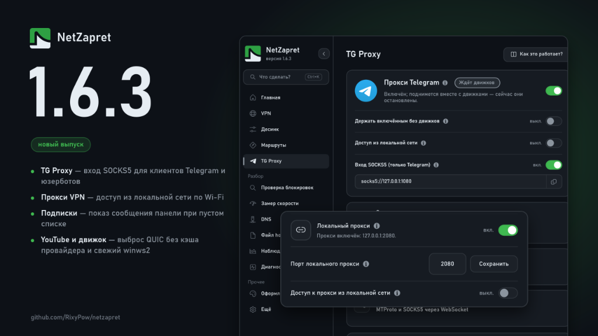

# Что нового в 1.6.3

## TG Proxy

### Новое:

**Вход SOCKS5 для Telegram.** Новый выключатель «Вход SOCKS5 (только Telegram)» на вкладке «TG Proxy»: клиенты и боты, которые умеют только SOCKS5, подключаются к прокси по адресу `socks5://127.0.0.1:1080` — его можно скопировать кнопкой. С включённым «Доступом из локальной сети» вход открыт и для других устройств в том же Wi-Fi. По умолчанию выключен.

## VPN

### Новое:

**Локальный прокси — из локальной сети.** В «Настройках туннеля» → «Локальный прокси» появился выключатель «Доступ к прокси из локальной сети»: телефон или приставка в том же Wi-Fi могут ходить через VPN компьютера. Прокси без пароля — включайте только дома. По умолчанию выключен.

### Исправления:

**Подписка с сообщением от панели.** Если панель вместо серверов присылает заглушки — например, «достигнут лимит устройств», — вкладка VPN теперь показывает этот текст строкой «Панель: …», а не пишет «0 серверов, sing-box не поддерживает».

**Гибрид и DNS роутера.** Если системный DNS — роутер или другой домашний адрес, его веб-панель на порту 443 больше не закрывается.

## Десинк

### Исправления:

**Автонастройка YouTube не закрывает кэш провайдера.** Выброс QUIC теперь касается только зарубежных узлов видео Google. Раньше он задевал и кэш провайдера, а у некоторых провайдеров кэш отвечает только по QUIC — видео переставало грузиться совсем.

**Автонастройка YouTube: честный перезамер.** После «Применить» окно ждёт, пока десинк поднимется, и только потом перемеряет. Раньше перезамер мог пройти без обхода, показать «хуже» и откатить настройку сам.

**Движок десинка обновлён** до свежей сборки winws2: исправления счётчиков, фрагментированных пакетов и QUIC.

## DNS

### Исправления:

**Адреса Comss.one и Zapret DNS узнаются сами.** Когда провайдер DNS меняет адрес, программа находит новый по имени, проверяет его и переходит на него — прежний выбор в настройках продолжает работать. Обновлены встроенные адреса Comss.one.

## Общее

### Исправления:

**Обновление при смене вкладки.** Ход закачки обновления больше не пропадает, если уйти с «Главной» и вернуться, а кнопка «Обновить» во время закачки неактивна.
