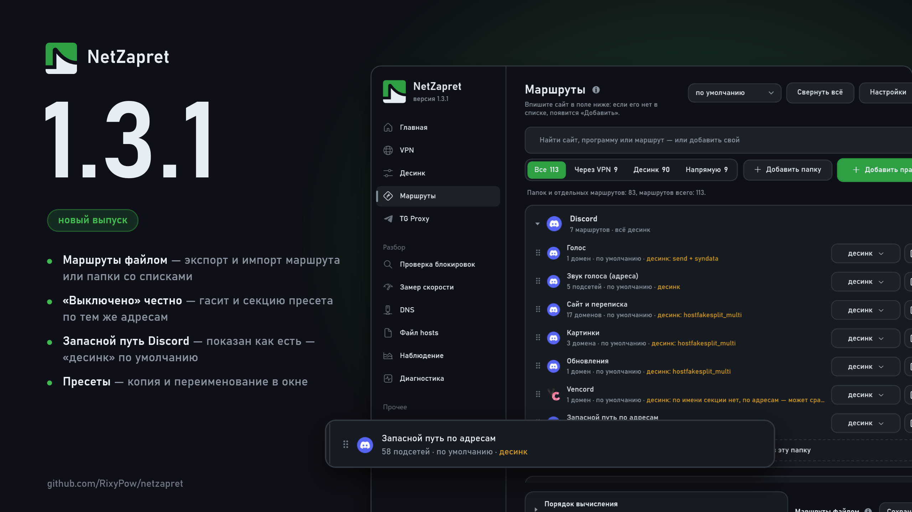

# Что нового в 1.3.1

## Маршруты

### Новое:

**Маршрут или папку маршрутов можно передать файлом.** В меню «⋯» у папки — своей, встроенной вроде Discord или папки программы — и у отдельного маршрута появился пункт «Экспорт…». В файл попадает всё: путь каждого маршрута (напрямую, десинк с рецептом, VPN с пулом, выключено), содержимое своих списков доменов и адресов, имя папки. Загрузить — «Добавить правило» → «Из файла…» или кнопкой «Загрузить» внизу. Маршрута, которого нет, программа заведёт со всеми его списками, а существующий заменит. Перед загрузкой окно показывает, что добавится, что заменится («было → станет») и что не загрузится; прежние правила и списки сохраняются копией. Ссылки на подписки и ключи серверов в файл не попадают.

### Исправления:

**«Выключено» у части по адресам теперь выключает и секцию пресета по тому же списку.** Прежде выключатель действовал только на туннель, а секция десинка по этим адресам продолжала работать. У «Запасного пути по адресам» Discord это секция «discord.com (IP fallback)»: окно показывало её выключенной, хотя она работала у всех. Теперь эта часть по умолчанию показана как «десинк» — так она и работала. На ней держатся голос Discord и часть сайтов на Cloudflare. Если секция мешает (Discord не открывается через десинк, а окно рецептов его открывает), выберите части «выключено».

## Десинк

### Новое:

**Копия и переименование пресета — из меню «⋯».** Копия ложится рядом под именем «Копия …» и попадает в «Пресеты сообщества» — её можно править, не трогая пресет из поставки. Переименовать можно свой пресет; выбор пресета и подделки секций переходят на новое имя.

## Общее

### Исправления:

**Окно обновления не показывает разметку картинки выпуска** — в каком бы виде она ни стояла над примечаниями.
