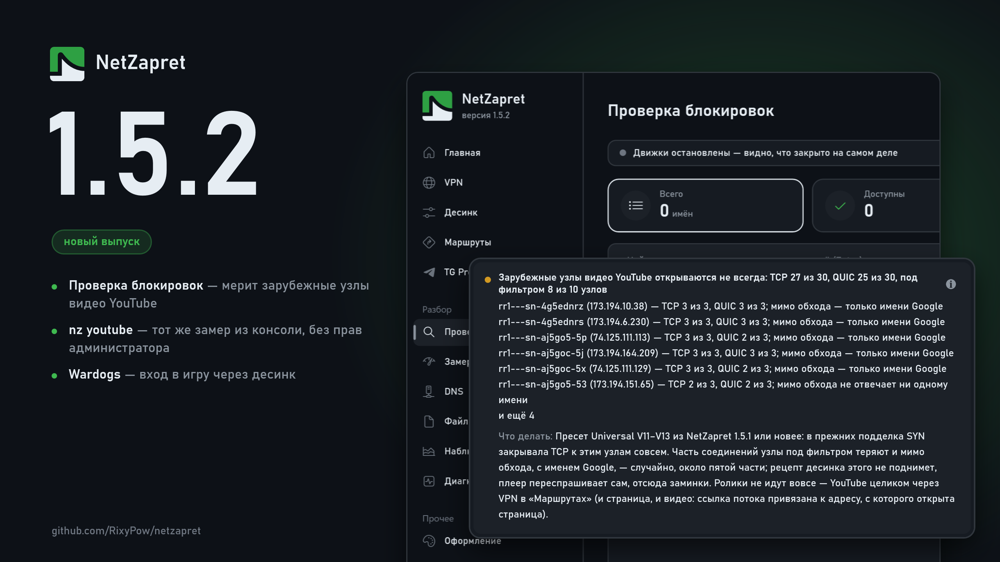

# Что нового в 1.5.2

## Проверка блокировок

### Новое:

**Проверка мерит зарубежные узлы видео YouTube.** Редкие и старые ролики плеер берёт не у провайдера, а с зарубежных узлов Google, и на многих из них стоит фильтр по адресу — популярное идёт, редкое стоит. Раньше проверка на это отвечала «YouTube доступен». Теперь, когда в прогоне есть YouTube, она проверяет десять таких узлов по TCP и QUIC и пишет в итоге, сколько соединений встало и сколько узлов под фильтром. Это же уходит в файл отчёта — по нему можно разобрать жалобу «ролики не идут».

**`nz youtube`** — тот же замер из консоли, без окна и без прав администратора, около 20 секунд.

### Исправления:

**Итог под таблицей больше не съедает её высоту.** В узком окне строк имён снова видно столько, сколько помещается.

## Маршруты

### Исправления:

**Wardogs: вход в игру — через десинк.** Сервер входа замерзал на первых десятках килобайт, а десинк его не трогал; теперь у него свой рецепт — наложение приветствием 4pda. Если вы сами задавали маршрут Wardogs в «Маршрутах», верните ему «По умолчанию».
