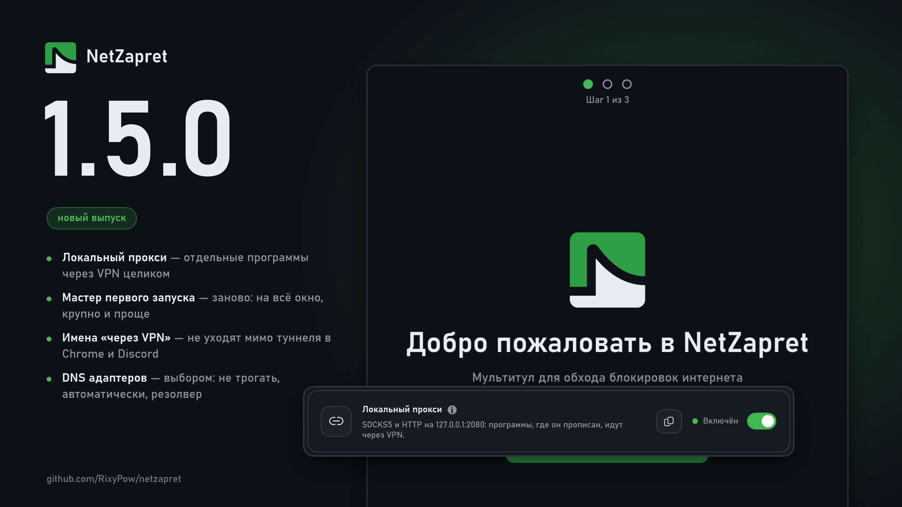

# Что нового в 1.5.0

## VPN

### Новое:

**Локальный прокси для отдельных программ.** Браузер, Telegram или игра с прокси `127.0.0.1:2080` в настройках идут через VPN целиком, остальные — своим путём. Включается в «Настройках туннеля»; там же порт и пул серверов. В обход домашней сети прокси не уходит, даже когда туннель в обходе.

**«VPN только через прокси» в «Гибриде».** Туннель поднимается только ради прокси, десинк работает как обычно.

**Карточки WARP и прокси на вкладке VPN — по выбору.** Карточка WARP подсказывает, что делать, когда учётная запись не заводится.

### Исправления:

**Имена «через VPN» больше не уходят мимо туннеля в Chrome и Discord.** DNS движка отдавал вместе с подставным адресом запись HTTPS с настоящими адресами, и браузеры на Chromium шли по ним напрямую.

**UDP через WireGuard и AmneziaWG** больше не отбрасывается.

## DNS

### Новое:

**DNS адаптеров Windows — выбором.** Не трогать (по умолчанию), автоматически или выбранный резолвер.

**Карточка «DNS движка»** со строкой «Сейчас»: каким резолвером и путём движок спрашивает имена.

### Исправления:

**Резолвер движка не застревает на запасном после перезапуска.**

## Маршруты

### Исправления:

**Маршрут программы больше не перебивает правила человека** — свои правила и выбор в «Маршрутах» сильнее выученного «Наблюдением».

## Десинк

### Новое:

**winws2 v1.0.7-34 и модули lua из Zapret GUI 21.1.7.232.** Game filter берёт и свой список сетей — первыми сети Overwatch.

### Исправления:

**«Подделки секций» узнают образец по содержимому.** ACTIVE_DISCORD_UDP.bin и ACTIVE_GAME_UDP.bin — это пакеты QUIC Steam и 4pda, теперь они так и помечены.

## Проверка блокировок

### Новое:

**Узлы, на которые компьютер реально ходил** — серверы картинок, видео и игр из кэша DNS. Итог — карточками.

## Ещё

### Новое:

**«Сайт не открывается?» называет рабочий резолвер.** Если резолвер движка даёт мёртвый адрес, подбор советует тот, что даёт рабочий; не нашлось — пробует VPN.

**Кнопка «Канал Слойки»** в «О программе».

## Общее

### Новое:

**Мастер первого запуска заново** — на всё окно, крупно и проще.

**В окне меньше текста.** Пояснения — в подсказках «i».
