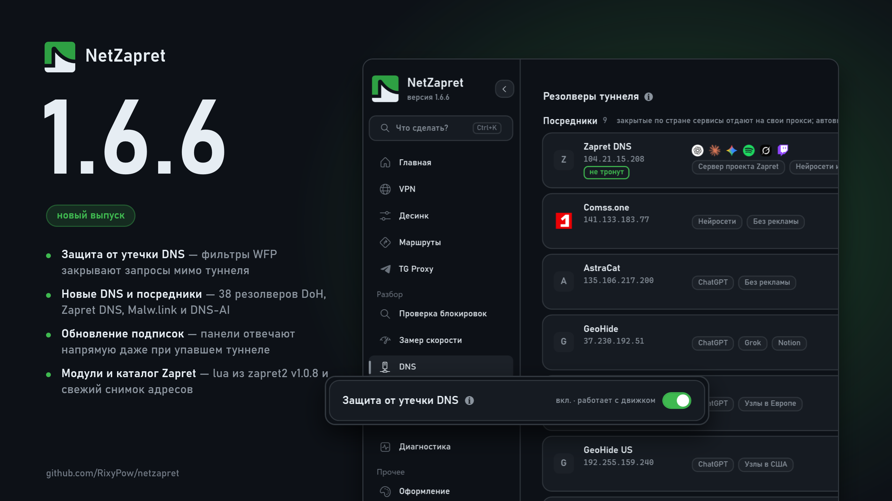

# Что нового в 1.6.6

## DNS

### Новое:

**Защита от утечки DNS мимо туннеля.** Новая настройка на вкладке «DNS» (включена по умолчанию): пока работает движок, фильтры WFP блокируют открытые DNS-запросы Windows на порт 53 в обход туннеля — провайдер и роутер больше не получают параллельные копии запросов (SMHNR). Вдобавок туннель отклоняет прямой DoT на порт 853 к системным резолверам, а для адаптера при наличии глобального IPv6 записываются и IPv6-адреса выбранного резолвера.

**Обновлён список DNS-провайдеров и посредников.** По образцу Zapret GUI 21.1.7.314 добавлены малоизвестные резолверы без фильтрации (`DNS4EU`, `Gcore`, `CZ.NIC`, `CIRA Canadian Shield`, `Freifunk München`, `StormyCloud`, `dnsdoh.art`, `Wikimedia DNS`), безопасные профили Яндекса, `BI.ZONE` и `Control D`, а в посредники для ИИ — `Malw.link`, `DNS-AI`, `Bezmezhau` и российский `GeoHide`. Обновлены рабочие адреса `Zapret DNS`, `Comss.one` и `AdGuard Семейного`.

## VPN

### Исправления:

**Обновление подписок при недоступном туннеле.** В режиме полного перехвата («Туннель») запросы к панелям подписок больше не уходят в упавший туннель, а при отказе основного эталона DoH адрес панели разрешается через запасные резолверы.

## Десинк

### Исправления:

**Обновлены модули Lua, списки и снимок каталога Zapret.** Модули `zapret-*.lua` синхронизированы с `zapret2 v1.0.8` (разбор IPv6-ссылок, `tls_dissect`, `synhide`), исправлена опечатка в домене картинок Discord (`discord-images.txt`) и снят свежий каталог адресов от 26.11.
