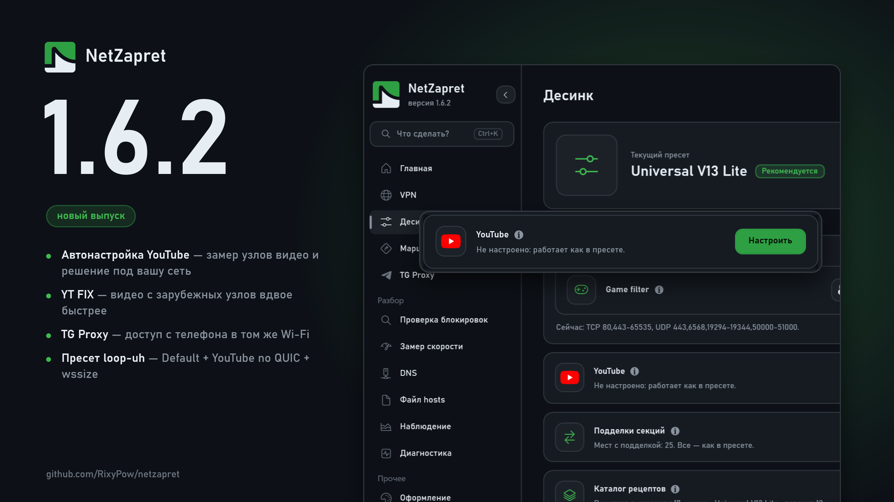

# Что нового в 1.6.2

## Десинк

### Новое:

**Автонастройка YouTube.** Карточка «YouTube» в «Десинке» → «Настроить»: программа меряет зарубежные узлы видео в вашей сети и сама решает, что включить — рецепт для узлов под фильтром, окно вдвое шире для далёких узлов, порог «далёких». Окно ведёт по шагам «Замер → Решение → Проверка», показывает узлы таблицей и после применения сравнивает «было → стало». Работает с любым пресетом, не только с YT FIX; не понравилось — «Снять».

**Пресет «Default + YouTube no QUIC + wssize»** от автора Zapret GUI: YouTube без QUIC и видео с малым окном. Для пробы — в нашем замере первое соединение с узлом видео шло быстро, а следующие почти не несли данных. По умолчанию остаётся V13 Lite.

### Исправления:

**YT FIX: видео с зарубежных узлов вдвое быстрее.** Медленный режим для узлов под фильтром теперь держит окно вдвое шире: в замере 11–21 Мбит/с на соединение против 5–9.

**YT FIX: узлы, закрытые наглухо, больше не теряют лишнюю секунду.** Раньше далёкому узлу первый обрыв прощался всегда, и на сетях, где узел не отвечает вовсе, каждый заход стоил лишнего сброса. Теперь прощается только узлу, который уже отвечал.

**Движок десинка обновлён** до свежей сборки winws2: исправлены контрольные суммы собранных пакетов в редких случаях.

## TG Proxy

### Новое:

**Доступ из локальной сети.** Выключатель на вкладке «TG Proxy»: включите — и Telegram на телефоне в том же Wi-Fi подключится к прокси на компьютере. Под выключателем появится ссылка для телефона. По умолчанию выключен.

## Общее

### Исправления:

**Меню в невысоком окне.** Полоса прокрутки больше не сжимает и не сдвигает пункты меню; список по-прежнему листается колесом и тачпадом.
