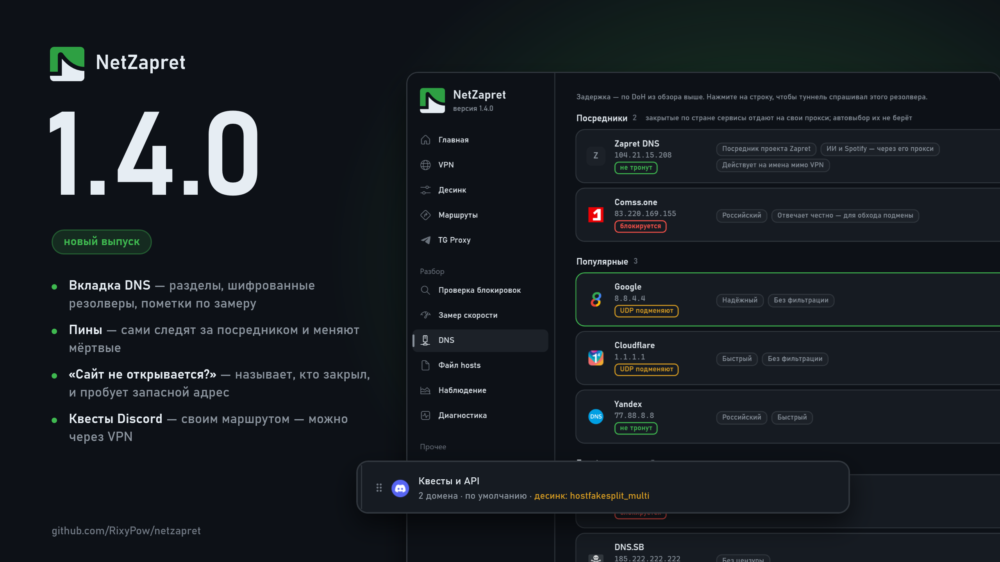

# Что нового в 1.4.0

## DNS

### Новое:

**Резолверы разделами, как в Zapret GUI.** Вместо одной ленты — посредники, популярные, без фильтрации, с фильтрацией, шифрованные и свои. Добавлены Zapret DNS (посредник проекта Zapret: ИИ и Spotify отдаёт на свой прокси, действует на имена мимо VPN), AdGuard Семейный и Control D без рекламы. Посредников автовыбор не берёт.

**Шифрованные резолверы — DNSCrypt, анонимный DNSCrypt и ODoH.** Работают через dnscrypt-proxy рядом с движком; выбираются строкой в разделе «Шифрованные», обзор меряет и их задержку.

**Пометки по замеру: «блокируется», «UDP подменяют», «не тронут».** Ставит их «Проверить» — по вашей сети, а не по чужому списку. «Блокируется» — DoH к резолверу не проходит; «UDP подменяют» — открытый DNS отвечает на закрытые имена подменой; «не тронут» — провайдер его не трогает. Пометки сохраняются между запусками, в подсказке — когда проверено.

**Пины сами следят за посредником.** Пин, поставленный NetZapret, помнит, от какого посредника он взят, и раз в 6 часов спрашивает его по DoH: посредник переехал на новый адрес — пин переезжает за ним, даже если старый ещё отвечает. Заменяется пин после двух неудач подряд и только когда сеть жива. В окне пина у каждого посредника видно, что он отдаёт сейчас; записи из снимка каталога — ниже, с датой снимка.

**Автовыбор резолвера — в карточке обзора**, а под итогом обзора — когда он был и кто быстрее всех по DoH.

### Исправления:

**Страница не прыгает при «Проверить»** — ни в обзоре резолверов, ни в карточке «Адреса в hosts».

**Каталог пинов — снимок от 05.11.** Умер прокси Zapret DNS 83.217.211.149, и с ним ушли сервисы, у которых других посредников не было.

## Главная

### Новое:

**Карточка состояния — волны туннельного эффекта.** Сколько волны проходит сквозь барьер — то и состояние: работает, с оговорками, запуск (барьер мерцает), движок упал, остановлено — ровная линия. Частота и рост волн — от трафика туннеля. Движутся ровно, в такт экрану, а пока окно в трее, не тратят процессор.

## Ещё

### Новое:

**«Сайт не открывается?» говорит, кто закрыл сайт.** Если сайт «закрыт полностью» или «режут по адресу», подбор проверяет его мимо десинка. Открылся — значит, закрывает наш десинк: итог называет секцию пресета и часть «Маршрутов», а не советует VPN.

**Запасной адрес Cloudflare.** Сайту на Cloudflare, закрытому по адресу, подбор пробует запасной адрес Cloudflare и, если сайт там открывается, ставит пин.

## Маршруты

### Новое:

**Discord: часть «Квесты и API».** Квесты и Orbs Discord выдаёт по стране, откуда пришёл запрос к API, — пином их не включить. Теперь discord.com с капчей — своей частью: поставьте её «через VPN», и квесты появятся, а картинки, шлюз и голос останутся, где были.

### Исправления:

**Узкая часть через VPN больше не перекрашивает широкую.** После «Квестов и API» через VPN «Сайт и переписка» Discord показывалась «через VPN», хотя её маршрут не менялся.

## Проверка блокировок

### Новое:

**ChatGPT, Claude, Gemini и Grok мимо туннеля и без пина — «отказ по стране».** Страница у них открывается, а отказ приходит на запрос к модели, которого проверка не шлёт, — раньше она писала «доступен». Первым советом — пин.

**Вердикт «режут длинное приветствие».** Провайдер режет приветствие TLS с постквантовым ключом (оно уходит двумя пакетами) — проверка узнаёт это по чужому имени на том же адресе.

## TG Proxy

### Новое:

**Прокси обновлён до tg-ws-proxy-rs 2.7.0.** Медиа через Cloudflare идут, как и прежде, по WebSocket: новый режим HTTP/2 оставлен выключенным — с ним картинки в Telegram не грузились.

## VPN

### Новое:

**AmneziaWG 3.** Параметры третьего поколения — ключ защиты заголовков, дополнение содержимого, таймеры — из .conf, ссылки и ключа vpn:// идут в движок. Сервер с кривым параметром пропускается один, остальные работают.

## Общее

### Исправления:

**Окно меньше подвисает.** «Оформление» открывается в 2–4 раза быстрее, «Наблюдение» не держит окно на каждом соединении, «Главная» не разбирает пресет при каждом заходе, сброс кэша DNS после пина идёт в фоне.

**Ключи серверов не попадают в журналы.** Если движок не смог настроить WireGuard и вывел дамп устройства, ключи в журналах на диске и в отчёте заменяются на «<скрыто>».
