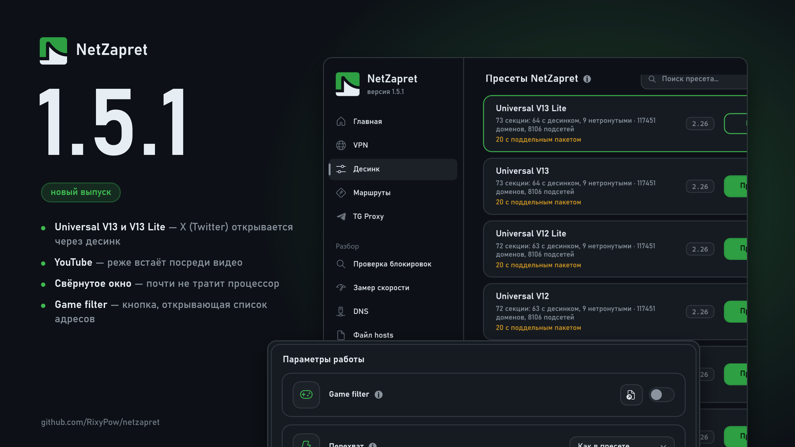

# Что нового в 1.5.1

## Десинк

### Новое:

**Пресеты Universal V13 и V13 Lite — X (Twitter) через десинк.** Это V12 и V12 Lite, в которых у X своя секция по имени и другой рецепт. Кто был на V12 или V12 Lite, один раз переведён на V13 или V13 Lite вместе с выбранными подделками секций; вернуться можно в любой момент. Для новых установок по умолчанию — V13 Lite.

**Кнопка у game filter открывает его список адресов** `ipset-all.txt`. Правка действует после перезапуска движков; обновление программы её перезапишет.

**winws2 — сборка от 09.11.** Поведение по умолчанию не изменилось.

### Исправления:

**YouTube реже встаёт посреди видео** (Universal V11–V13). К зарубежным узлам видео Google соединения через десинк не открывались вовсе, и когда срывался QUIC, плееру было некуда отступить. Теперь десинк их не трогает.

## Маршруты

### Исправления:

**Пин «X (Twitter)» без мёртвых адресов** — страница X больше не стоит чёрной из-за адресов, которые не отвечают.

## Общее

### Исправления:

**Свёрнутое окно почти не тратит процессор.** Пока окно свёрнуто, волна «Главной», опрос движков и проверка выхода на вкладке VPN стоят.

**Вкладка VPN открывается быстрее, разделы проявляются плавнее.**
