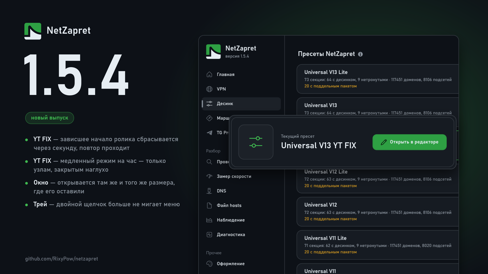

# Что нового в 1.5.4

## Десинк

### Исправления:

**Universal V13 YT FIX: ролик с зарубежного узла начинается быстрее.** Первое соединение, у которого фильтр срезал ответ, раньше висело несколько секунд, пока браузер не сдавался. Теперь через секунду без ответа оно сбрасывается, и плеер сразу повторяет запрос — уже с рецептом, и повтор проходит. Соседние узлы той же группы тоже получают рецепт сразу, а не зависают каждый по очереди.

**YT FIX видит узел и под вторым именем.** Перед роликом плеер проверяет связь с узлом через имя на c.youtube.com, и раньше рецепт этих соединений не касался. На закрытых узлах таких проверок проходило 193 из 240, теперь 229 из 240.

**YT FIX реже уходит в медленный режим на час.** Час теперь достаётся только узлу, закрытому наглухо. Узел, который хоть раз отвечал, после среза получает рецепт на минуту, а не держится около 7 Мбит/с целый час.

## Общее

### Новое:

**Окно открывается там же, где его оставили.** Место, размер и развёрнутое окно запоминаются при выходе и при уходе в трей. Раньше после перезапуска окно снова вставало маленьким посередине экрана.

**nz start, stop и restart.** Запустить, остановить и перезапустить движки из консоли без прав администратора: просьбу выполняет открытое окно программы.

### Исправления:

**Двойной щелчок по значку в трее больше не мигает меню.** Правая кнопка открывает меню сразу. Левая — через полсекунды, если второго щелчка не было; двойной щелчок открывает окно.
