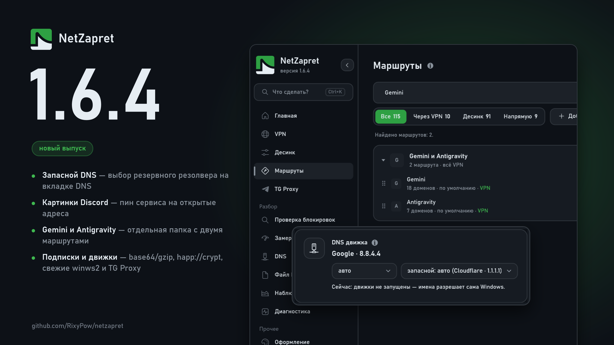

# Что нового в 1.6.4

## Маршруты

### Новое:

**Пин сервиса для картинок Discord.** У части «Discord → Картинки» появился особый путь «Пин сервиса» на открытые по IP адреса `162.159.136–138.232`: помогает, когда провайдер закрывает стандартные адреса `media.discordapp.net` ещё на уровне TCP.

**Gemini и Antigravity — в одной папке.** Вынесены с полки «Нейросети» в общую папку «Gemini и Antigravity» (рядом с Claude) с двумя раздельными маршрутами: редактор кода Antigravity и Gemini Code Assist теперь можно направить отдельно от чата Gemini. Прежние правила и пины сохраняются.

## DNS

### Новое:

**Выбор запасного резолвера.** В карточке «DNS движка» появился список «Запасной» — можно выбрать, на какой DoH-резолвер движок переключится при отказе основного (по умолчанию — автовыбор). Карточки «DNS движка» и «Резолверы системы» выровнены по высоте.

## VPN

### Исправления:

**Подписки: многострочный base64, gzip и Happ.** Подписки в многострочном base64 с BOM и со сжатием gzip больше не падают с ошибкой разбора. Если панель отвечает 200 OK, но серверы не разобрались, программа повторяет запрос под User-Agent Happ. При вставке шифрованной ссылки `happ://crypt…` теперь показывается прямое пояснение.

## Десинк

### Новое:

**Рецепт `clone-fake-multidisorder` в каталоге.** Клонирует реальное TLS-приветствие клиента (`tls_client_hello_clone`) вместо статического образца.

### Исправления:

**Движок десинка обновлён** до свежей сборки winws2 (`-native-101`): правки IPv6, `ipcache-hostname`, `dp_rediscovery` и диапазона `lua_Integer`. Разбор списков доменов теперь учитывает префиксы `!` (исключение) и `^` (точное совпадение).

**Обновлён снимок каталога Zapret** (от 21.11): убраны неработающие адреса прежних посредников.

## TG Proxy

### Исправления:

**Прокси Telegram обновлён до 2.7.2:** повисшие клиентские сессии закрываются через 15 минут простоя с TCP keepalive, закреплённый MTProto-уровень сначала пробует доступные прокси вместо ушедших в паузу, исправлен исходящий FakeTLS.

## Наблюдение

### Исправления:

**Чистое копирование сайтов.** Соединения `tg-ws-proxy` и `dnscrypt-proxy` больше не попадают в «Скопировать» («Сайты» и «Домены целиком»).

## Диагностика

### Исправления:

**Путь к журналу TG Proxy** в `doctor.txt` теперь печатается без подмены `\t` на табуляцию.
