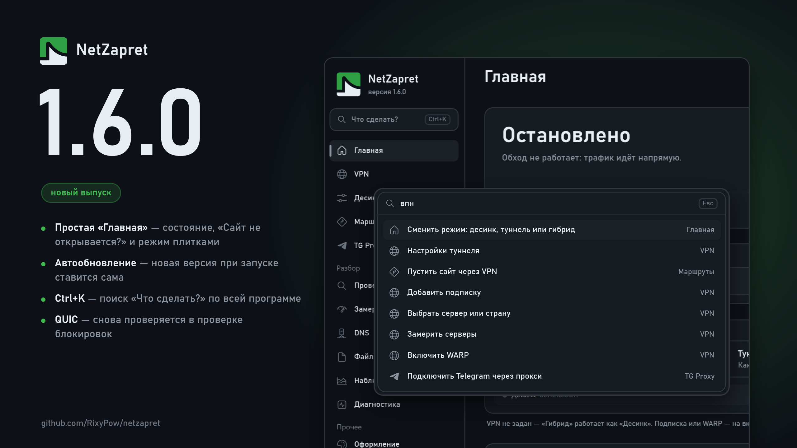

# Что нового в 1.6.0

## Главная

### Новое:

**Простая «Главная».** Сверху — крупная карточка состояния с кнопкой «Запустить» или «Остановить». Под ней поле «Сайт не открывается?»: впишите сайт и нажмите «Починить» — программа сама подберёт ему путь и запишет правило. Ниже — режим работы плитками («Как Zapret», «Как обычный VPN», «Zapret и VPN вместе»), пресет, сервер и состояние обоих движков. Внизу — «Обновление» и «Собрать отчёт для разбора».

**Прежний вид остался.** Переключатель «Простой / Продвинутый» справа в шапке: продвинутый — всё, что было на «Главной» раньше, с параметрами подключения, номерами процессов и быстрыми действиями.

## Общее

### Новое:

**Автообновление.** Новая версия, найденная при запуске программы, ставится сама — без нажатия «Обновить». При автозапуске программа после обновления возвращается в трей и снова поднимает обход. Ставится только найденное при запуске: позже обновление по-прежнему предлагается окном. Выключатель — в окне обновления.

**Автозапуск и автообновление — в мастере первого запуска.** На третьем шаге две карточки с выключателями, оба включены. Кто программой уже пользуется, у того ничего не меняется: автообновление можно включить в окне обновления, автозапуск — в «Ещё».

**Поиск «Что сделать?» — Ctrl+K.** Строка под эмблемой в меню: впишите задачу своими словами («добавить подписку», «логи», «тема», «впн») — поиск покажет, где это. Впишите сайт — первыми встанут «Проверить сайт» и «Показать маршрут сайта».

**Меню сворачивается до значков.** Кнопка «Свернуть меню» внизу: остаются одни значки, подписи — в подсказках. Удобно на ноутбуках. Щелчок по эмблеме открывает «Главную».

## Проверка блокировок

### Исправления:

**QUIC снова проверяется.** С выпусков конца октября проба QUIC не работала ни у кого: программа не находила свою библиотеку QUIC. Из-за этого проверка блокировок не видела, режут ли QUIC, а отчёт по YouTube писал «QUIC не мерился».

**Отчёт по YouTube различает кэш провайдера и площадку Google.** Если у провайдера своего кэша Google нет, отчёт теперь так и говорит — и что всё видео, популярное тоже, идёт с зарубежных узлов под фильтром. Раньше такую площадку во Франкфурте или Стокгольме он называл «кэшем провайдера».

## Десинк

### Новое:

**Подделки game filter выбираются в «Подделках секций».** У game filter три подделки — две для TCP, одна для UDP, — и раньше сменить их было нельзя. Теперь они в том же списке, что подделки секций пресета, под именем «game filter». Выбор один на все пресеты и все игры сразу.

### Исправления:

**Свой рецепт для YouTube больше не выключает YT FIX.** Если в «Маршрутах» для googlevideo или youtube был выбран свой рецепт, пресет Universal V13 YT FIX молча переставал работать. Теперь его шаги идут вместе со своим рецептом.

**Движок десинка обновлён** до свежей сборки winws2. Для Windows в ней ничего не изменилось; проверено на всех пресетах.
