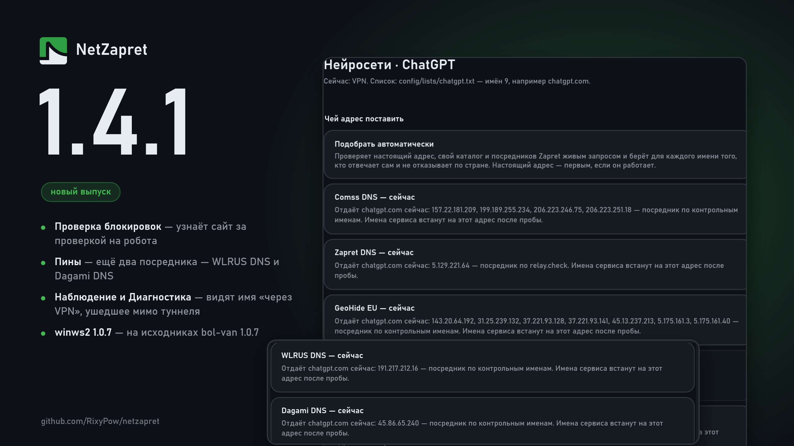

# Что нового в 1.4.1

## Проверка блокировок

### Новое:

**Вердикт «за проверкой на робота».** Сайт за защитой от ботов отдаёт пробе маленькую страницу с капчей, и раньше проверка писала «доступен», хотя в браузере сайт вставал без стилей или не грузился вовсе. Теперь такая страница — отдельный вердикт с советом открыть сайт в браузере, а её скрипты докачиваются: если они замерзают, проверка так и скажет. «Сайт не открывается?» по такому замеру маршрут не записывает.

## DNS

### Новое:

**Ещё два посредника для пинов — WLRUS DNS и Dagami DNS.** Из шести прежних живыми отвечают три, и если умрёт кто-то из них, автозамене пина было бы не на что его менять. Оба отдают ChatGPT, Gemini и Grok через свой прокси; в окне пина они видны среди посредников.

### Исправления:

**Подпись карточки «Резолверы системы»** больше не говорит, что через них идёт всё мимо туннеля: пока работают движки, их запросы забирает движок.

## Наблюдение

### Новое:

**«Мимо туннеля» там, где правило ведёт в VPN, а соединение туда не попало.** Если имя «через VPN» получило настоящий адрес вместо подставного (например, от стороннего DNS-клиента), в «Гибриде» оно идёт мимо туннеля — а «Наблюдение» писало «туннель». Теперь такая строка помечена и объяснена, а в отчёте посчитано, сколько их было.

## Диагностика

### Новое:

**Проверка, что имена «через VPN» и правда уходят в туннель.** «Диагностика» спрашивает у Windows несколько таких имён, как любая программа, и ждёт подставной адрес. Пришёл настоящий — красная строка с причиной: сторонний DNS-клиент, резолвер новой сети после её смены (нужен перезапуск движков) или резолвер по локальному IPv6.

## Десинк

### Новое:

**winws2 обновлён до v1.0.7-34** (сборка loop-uh на исходниках bol-van 1.0.7). Строка запуска и фильтр перехвата на всех пресетах — те же, что у прежнего.

## Маршруты

### Исправления:

**Пин на адрес самого сайта больше не значится спором с десинком.** Карточка «Правила спорят» писала, что рецепт к прибитому имени не применится, а у пинов с пометкой десинка (раздел «Пины напрямую») он применяется.
