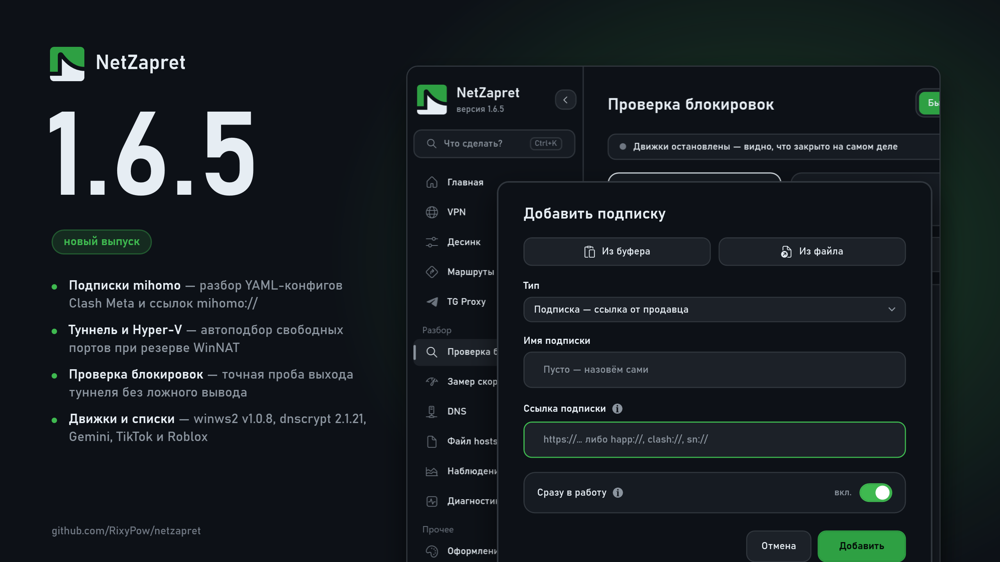

# Что нового в 1.6.5

## VPN

### Новое:

**Подписки в формате mihomo / Clash Meta.** Программа теперь разбирает YAML-конфиги подписок (`proxies:`, включая ссылки-обёртки `mihomo://install-config?url=…` и base64) со всеми основными протоколами: VLESS (REALITY, ws, grpc, xhttp), VMess, Trojan, Shadowsocks, Hysteria и Hysteria2, TUIC, AnyTLS, WireGuard, SOCKS5 и HTTP.

### Исправления:

**Запуск туннеля рядом с Hyper-V, WSL2 и Docker.** Когда служба Windows WinNAT резервирует стандартные служебные порты (`9090` или `21090`), `sing-box` больше не падает с ошибкой доступа к сокету — NetZapret сам подбирает свободные порты для Clash API и проверки выхода.

## Проверка блокировок

### Исправления:

**Точнее проба «доходит ли туннель».** Контрольная проба больше не винит сборку конфига по чужому серверу, когда в группе автовыбора активный выход не совпал; если сработал запасной сервер, проверка прямо называет его и советует переключиться во вкладке «VPN». Сбор списка выходов теперь работает и без ссылки на подписку — с отдельными ключами, пулами и WARP.

## Маршруты

### Исправления:

**Обновлены списки Gemini, TikTok и Roblox.** В `gemini.txt` добавлены `jnn-pa.googleapis.com` и вспомогательные API-домены Google (убирает ошибку аттестации в веб-чате Gemini), в `tiktok.txt` добавлены недостающие домены, в `roblox-network.txt` — новые подсети игровых серверов (`/20`).

## Десинк

### Исправления:

**Движок десинка обновлён до `winws2 -native-113`.** Включает правки из `zapret2 v1.0.8`: исправления `ip6_preserve_next`, пустых переходов хоста в `dp_discovery` и предупреждений о пустых профилях.

## DNS

### Исправления:

**Шифрованный DNS (`dnscrypt-proxy`) обновлён до 2.1.21.** Отброс пересланных ответов с несовпадающим DNS-вопросом, исправление выбора IPv6-реле для Anonymized DNSCrypt и ответов wildcard UDP-слушателей.
