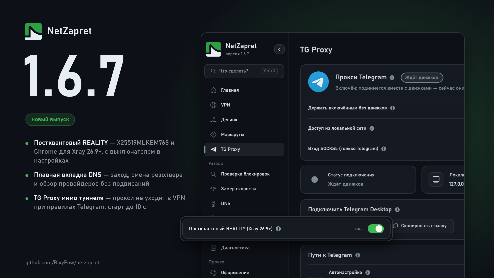

# Что нового в 1.6.7

## VPN

### Новое:

**Постквантовый REALITY (Xray 26.9+).** Подписки с серверами VLESS + REALITY на Xray 26.9.8 и новее снова работают: движок передаёт постквантовый ключ `X25519MLKEM768` и отпечаток Chrome в туннеле, замерах и проверке блокировок. В «Настройках туннеля» есть выключатель на случай старых серверов REALITY (Xray до 25.4 / sing-box до 1.11).

## DNS

### Исправления:

**Вкладка «DNS» больше не подвисает.** Открытие вкладки, переключение резолвера, загрузка значков и обзор провайдеров вынесены из потока окна — список из сорока с лишним резолверов работает плавно. В таблице обзора расширена колонка «Провайдер».

## TG Proxy

### Исправления:

**Прокси Telegram не уходит в VPN и быстрее стартует.** При правилах Telegram через VPN трафик `tg-ws-proxy` теперь идёт напрямую мимо туннеля, а автонастройка перед запуском ограничена 10 секундами вместо 30.
