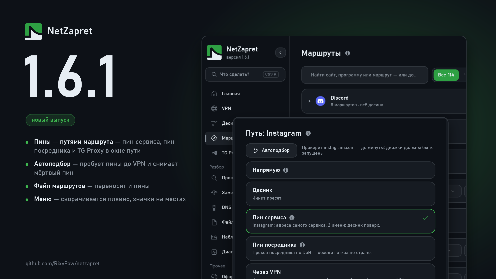

# Что нового в 1.6.1

## Маршруты

### Новое:

**Пины и прокси Telegram — путями маршрута.** В окне пути между «Десинком» и «Через VPN» — новые пути: «Пин сервиса» (адреса самого сервиса: Instagram, X, YouTube, Discord, WhatsApp, GitHub и другие), «Пин посредника» (прокси посредника вроде Comss или GeoHide — для сайтов, которые отказывают России) и «TG Proxy» у приложения Telegram. Булавки на карточках больше нет — всё в окне пути. Пины по-прежнему пишутся в hosts, а маршрут помнит, на каком пине он держится.

**Файл маршрутов переносит и пины.** Загрузка файла маршрутов ставит пины его маршрутов в hosts и снимает пины ушедших.

### Исправления:

**Шаг «через VPN» в подборе больше не принимает отказ робота за отказ сайта.** Сайты за защитой вроде CloudFront отвечали подбору 403 и через VPN, и VPN не предлагался, хотя руками работал.

**Проба посредника идёт тем же путём, каким потом работает пин.** Раньше подбор пина и автозамена проверяли посредника через десинк и могли забраковать живой адрес и оставить мёртвый.

## Проверка блокировок

### Новое:

**Автоподбор пробует пины и прокси Telegram.** «Подобрать маршрут» и «Сайт не открывается?» после рецептов десинка пробуют пин сервиса и пин посредника — до VPN. Для приложения Telegram проверяются пути прокси.

**Автоподбор снимает мёртвый пин.** Если имя прибито в hosts к адресу, который сайт не открывает, подбор снимает пин и проверяет сайт заново. Раньше он перебирал рецепты на мёртвом адресе — пока стоит пин, ни десинк, ни VPN до имени не доходят.

### Исправления:

**Ход подбора читается.** Итог каждого шага — под названием во всю ширину и по-русски («соединение закрыто без ответа») вместо английского текста ошибки.

**mihoyo.com больше не проверяется** и убран из маршрута HoYoverse: имя устарело.

## Общее

### Исправления:

**Меню сворачивается плавно, и ничего в нём не сдвигается.** Свернуть и развернуть — стрелкой у имени или щелчком по эмблеме; значки остаются на своих местах.

## Десинк

### Исправления:

**Движок десинка обновлён** до свежей сборки winws2.
