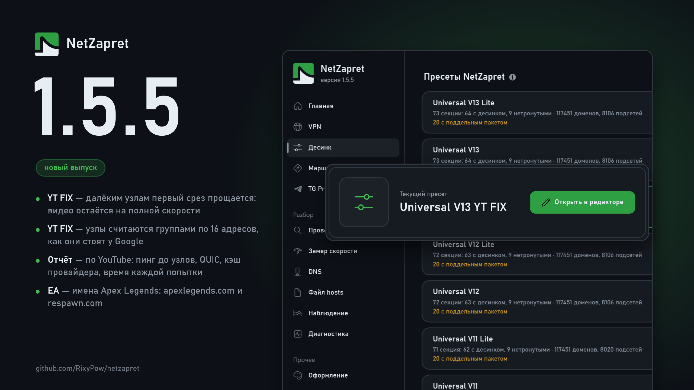

# Что нового в 1.5.5

## Десинк

### Исправления:

**Universal V13 YT FIX: видео с далёких узлов реже идёт в медленном режиме.** Рецепт с малым окном ограничивает скорость соединения, и чем дальше узел, тем сильнее: при задержке 50 мс это около 10 Мбит/с, при 25 мс — около 20. Раньше хватало одного срезанного ответа, чтобы следующее соединение, которое и понесёт видео, пошло медленным. Теперь пресет сам меряет задержку до узла и далёкому узлу первый срез прощает: повтор идёт обычным соединением и чаще всего проходит на полной скорости. Медленный режим включается только со второго среза подряд. Близким узлам рецепт включается сразу, как прежде. Цена: у далёких узлов каждый срез стоит секунду ожидания и повтор.

**YT FIX считает узлы группами по 16 адресов.** Так они стоят у Google. Группа из 32 адресов склеивала две разные площадки, и ответы работающей могли мешать пресету распознать закрытую.

## Проверка блокировок

### Новое:

**Подробный отчёт по YouTube.** По каждому зарубежному узлу видео теперь видно задержку, время каждой попытки по TCP и QUIC, сколько ответов пришло с опозданием и какая скорость возможна в медленном режиме. Отдельной строкой — узел кэша провайдера и пресет: есть ли в нём рецепт для узлов видео. Сводка говорит, у скольких узлов не проходит QUIC — с них видео пойдёт по TCP. То же печатает `nz youtube`.

## Диагностика

### Новое:

**Раздел YouTube в отчёте для поддержки.** Архив отчёта несёт свежий замер узлов видео в файле `youtube.txt`, даже если проверку блокировок не запускали. Сбор отчёта стал дольше примерно на 20 секунд.

## Маршруты

### Исправления:

**Apex Legends идёт вместе с «EA и Origin».** Сайт игры и Respawn (`apexlegends.com`, `respawn.com`) раньше шли своим путём: если перевести «EA и Origin» на VPN или «напрямую», они оставались на прежнем.
